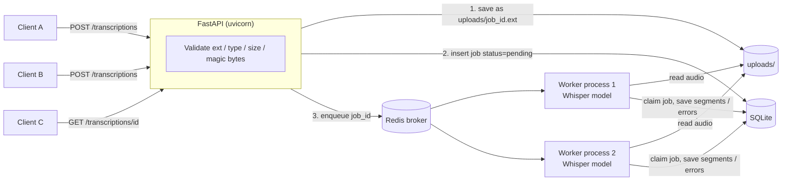

# Audio Transcription Service

A small backend that accepts audio uploads (WAV, MP3, M4A), transcribes them in the background with the open-source [OpenAI Whisper](https://github.com/openai/whisper) model, and returns the text with **per-segment start/end timestamps**.

- **FastAPI**: REST API. Validates and saves uploads, then returns a job ID right away.
- **Celery + Redis**: background job queue. Workers run Whisper with configurable concurrency.
- **SQLite + SQLAlchemy**: job status, error details and results.
- **Local disk**: the audio files. They are never stored in the database.

No paid APIs. Everything runs locally.

---

## 1. Architecture



**Request flow**

1. `POST /transcriptions` validates the file and streams it to `uploads/<job_id>.<ext>`.
2. It inserts a row (`status = pending`) and pushes only the `job_id` onto the Redis queue.
3. It returns `202 Accepted` with the job ID. The model never runs inside the request.
4. A Celery worker picks up the message, atomically claims the job (`pending → processing`), runs Whisper, and saves the segments (`completed`) or the error (`failed`).
5. The client polls `GET /transcriptions/{job_id}`.

### Project layout

```text
app/
├── main.py                 FastAPI app; creates tables + upload dir on startup
├── api/routes.py           Endpoints, upload validation, response building
├── core/config.py          Settings from environment variables / .env
├── db/database.py          Engine, session, SQLite WAL + busy timeout
├── db/models.py            TranscriptionJob table and JobStatus enum
├── services/transcription.py  Whisper loading (once per process) and transcription
├── workers/celery_app.py   Celery config (acks_late, prefetch=1, model preload)
├── workers/tasks.py        The task: claim, transcribe, retry/backoff, save
└── schemas.py              Pydantic response models
tests/
├── conftest.py             Temp DB + upload dir, no Redis, no model
├── test_api.py             Validation, status codes, responses, retry endpoint
└── test_tasks.py           Success, permanent vs. temporary failures, idempotency
```

## 2. How concurrent uploads are handled

- **The API never waits for transcription.** The upload handler only saves the file, writes a DB row and enqueues a message, which takes milliseconds. It then returns `202`.
- **Uploads run in parallel.** The endpoint is a plain `def`, so FastAPI runs each request in its thread pool. Several uploads can stream to disk at the same time. You can run more uvicorn workers (`--workers 4`) for more throughput.
- **No file collisions.** Every upload is saved as `uploads/<uuid4-job-id>.<ext>`, never under the client's filename. Ten users uploading `audio.mp3` at once get ten different files.
- **Transcription concurrency is bounded and configurable.** `CELERY_WORKER_CONCURRENCY=N` starts N worker processes, so N files are transcribed at once. Extra jobs wait in Redis as `pending`. They are not dropped and they don't overload the machine. You can also start more `celery worker` commands, on more machines if needed, that point at the same Redis.
- **Fair distribution.** `worker_prefetch_multiplier=1` means a process reserves one job at a time. A process busy with a long file doesn't hold other jobs that an idle process could start.
- **SQLite with several writers.** The API and every worker process write to the same DB file. The DB runs in WAL mode with a 5 s busy timeout, so readers don't block the writer and writers queue instead of erroring. Writes here are tiny and rare, so this is fine for a demo. See *Limitations*.

## 3. How Celery and Redis work together

- **Redis** is the *message broker*: a queue that holds "transcribe job X" messages.
- **Celery** is the *worker framework*. `transcribe_audio.delay(job_id)` serializes the call into a JSON message and pushes it onto Redis. `celery worker` processes pop messages and run the task function.
- No Celery *result backend* is used. Status and results live in **our own** database, which the API already reads, so there is a single source of truth.
- Settings that matter (in `app/workers/celery_app.py`):
  - `task_acks_late=True`: the message is acknowledged *after* the task finishes. If a worker crashes mid-job, Redis redelivers the message instead of losing it.
  - `task_reject_on_worker_lost=True`: same idea, for a killed child process.
  - `visibility_timeout=4h`: how long Redis waits for an ack before it redelivers. It must be longer than your longest job.
- **Model loading.** Whisper is loaded once per worker process (in the `worker_process_init` signal, after fork) and cached in a module-level variable. Every later task in that process reuses it. It is never loaded per task.

## 4. Retries and failure recovery

### Two kinds of failures

| Kind | Examples | What happens |
|---|---|---|
| **Permanent** (`InvalidAudioError`) | Corrupt file, not really audio, no audio stream, file missing | Marked `failed` straight away with `retryable: false`. **Not retried.** The same bad bytes would fail the same way. |
| **Temporary** (any other exception) | Out of memory, model load hiccup, disk/IO error | Retried automatically with exponential backoff, up to `TASK_MAX_RETRIES`. |

To tell them apart, the service first decodes the file with FFmpeg (`whisper.load_audio`). An FFmpeg failure means the file is bad. A failure after that means something else went wrong.

### Automatic retries (exponential backoff)

`app/workers/tasks.py` calls `self.retry(countdown=...)` with:

```
delay = TASK_RETRY_BACKOFF_BASE_SECONDS * 2^retry_number   (+ up to 10% jitter, capped at TASK_RETRY_BACKOFF_MAX_SECONDS)
→ ~5s, ~10s, ~20s with the defaults
```

Between attempts the job goes back to `pending`, and `error` shows the last failure, e.g. `"Attempt 2 failed: ... Retrying in 10s."`. After `TASK_MAX_RETRIES` retries (4 attempts in total by default) the job becomes `failed` with `retryable: true`.

### Job statuses

```
pending ──claim──▶ processing ──▶ completed
   ▲                   │
   └── temporary error ┤ (retries left)
                       ▼
                    failed ──POST /retry (retryable only)──▶ pending
```

### Idempotency: avoiding duplicate work

Celery with Redis gives **at-least-once** delivery, not exactly-once. A message can be delivered twice, for example after a worker crash or a visibility timeout. The task protects against that:

1. **Atomic claim.** The task starts with a single statement:
   `UPDATE jobs SET status='processing' WHERE id=? AND status='pending'`.
   If two workers get the same message, only one updates a row. The other sees `rowcount == 0` and exits.
2. **Completed jobs are never redone.** A duplicate message for a `completed` job is a no-op, and the saved result is never overwritten.
3. **Crash recovery.** If a worker dies mid-job, the row stays `processing`. When the message is redelivered, the job can be reclaimed once `started_at` is older than `STALE_JOB_SECONDS`.
4. **Result first, cleanup second.** The transcript is committed *before* the audio file is deleted. A crash between the two leaves a harmless orphan file, never a lost result.

This *reduces* duplicate work. It does not make it impossible: a job that is still running after `STALE_JOB_SECONDS` could be picked up again. Set that value well above your longest expected transcription.

### Investigating and retrying a failed job manually

- `GET /transcriptions/{id}` shows `error`, `retryable` and `attempts`.
- Worker logs include the job ID on every line (`Job <id>: ...`), so `grep <id>` gives the full history.
- The DB row keeps `error_message`, `attempts`, `started_at` and `completed_at`:
  `sqlite3 transcriptions.db "select id,status,attempts,error_message from transcription_jobs where status='failed';"`
- The audio of a **failed** job is kept on disk, so you can inspect it with `ffprobe uploads/<id>.mp3`.
- Once the cause is fixed (e.g. more memory), call `POST /transcriptions/{id}/retry`. It is only allowed when the job is `failed`, `retryable` is true, and the audio file still exists. Otherwise it returns `409` with the reason.

## 5. API

Interactive docs: http://localhost:8000/docs

### `POST /transcriptions`

Multipart upload, field name `file`. Allowed: `.wav`, `.mp3`, `.m4a`, up to `MAX_UPLOAD_SIZE_MB`.

```bash
curl -X POST http://localhost:8000/transcriptions -F "file=@sample.mp3"
```

```json
{"job_id": "47ad18f02a8d48b3b336d256bdc0b65a", "status": "pending"}
```

| Code | When |
|---|---|
| `202` | Accepted and queued |
| `400` | Empty file, no filename, or content doesn't look like the claimed format |
| `413` | File too large |
| `415` | Unsupported extension, or content type doesn't match the extension |
| `422` | No `file` field in the request |
| `503` | Redis unreachable. The job is saved as `failed`/retryable and `detail.job_id` is returned, so you can retry it later. |

### `GET /transcriptions/{job_id}`

```bash
curl http://localhost:8000/transcriptions/47ad18f02a8d48b3b336d256bdc0b65a
```

Completed (real output from the `tiny` model on a 22 s clip):

```json
{
  "job_id": "47ad18f02a8d48b3b336d256bdc0b65a",
  "status": "completed",
  "filename": "jfk2.mp3",
  "attempts": 3,
  "created_at": "2026-10-15T10:17:28.898138Z",
  "completed_at": "2026-10-15T10:17:38.898483Z",
  "language": "en",
  "text": "And so my fellow Americans ask not. What your country can do for you ...",
  "segments": [
    {"start": 0.0,  "end": 4.78, "text": "And so my fellow Americans ask not."},
    {"start": 5.26, "end": 8.0,  "text": "What your country can do for you"},
    {"start": 8.0,  "end": 10.6, "text": "asks what you can do for your country"}
  ],
  "error": null,
  "retryable": null
}
```

Failed:

```json
{
  "job_id": "9ba5b6995a6743d78161a04e69c07c98",
  "status": "failed",
  "attempts": 1,
  "error": "Could not decode audio: 9ba5b6995a6743d78161a04e69c07c98.wav: Invalid data found when processing input",
  "retryable": false,
  "...": "..."
}
```

`404` if the job doesn't exist.

### `POST /transcriptions/{job_id}/retry`

```bash
curl -X POST http://localhost:8000/transcriptions/e37a9baa2d76427680fc3efbd890285a/retry
```

```json
{"job_id": "e37a9baa2d76427680fc3efbd890285a", "status": "pending"}
```

`202` when queued, `404` for an unknown job, and `409` if the job isn't `failed`, failed permanently, already has a retry in progress, or its audio file is gone.

### `GET /health`

```json
{"status": "ok", "database": "ok", "broker": "ok"}
```

`status` is `"degraded"` if the database or Redis can't be reached.

## 6. How segment timestamps are generated

The timestamps come **from Whisper itself**. Whisper processes audio in 30-second windows. While decoding, it predicts special timestamp tokens that mark where each phrase starts and ends. `model.transcribe()` turns them into a list of segments, each with `start`, `end` (seconds from the start of the file) and `text`. `app/services/transcription.py` takes those values as they are, rounds them to 2 decimals, and strips extra whitespace from the text. Nothing is estimated or spread out evenly.

## 7. Prerequisites

- **Python 3.11+**
- **FFmpeg** on your `PATH`. Whisper uses it to decode MP3/M4A/WAV.
  - Ubuntu/Debian: `sudo apt install ffmpeg`
  - macOS: `brew install ffmpeg`
- **Redis 6+**
  - Ubuntu/Debian: `sudo apt install redis-server` (then `sudo systemctl start redis-server`)
  - macOS: `brew install redis && brew services start redis`
  - or, if you already have Docker: `docker run -d -p 6379:6379 redis:7-alpine`
- About 1–2 GB of free RAM per worker process for `base` (less for `tiny`)

## 8. Local setup and running

```bash
cd audio-transcription-service
python3.11 -m venv .venv
source .venv/bin/activate

# Optional but recommended on machines without an NVIDIA GPU:
# install the CPU-only PyTorch build first (~200 MB instead of several GB).
pip install torch --index-url https://download.pytorch.org/whl/cpu

pip install -r requirements.txt
cp .env.example .env            # edit if needed
```

Run three things, each in its own terminal (with the venv activated):

```bash
# 1. Redis (skip if it's already running as a service)
redis-server

# 2. API
uvicorn app.main:app --reload --port 8000

# 3. Worker (concurrency comes from CELERY_WORKER_CONCURRENCY)
celery -A app.workers.celery_app worker --loglevel=INFO
```

The first job downloads the Whisper model weights to `~/.cache/whisper` (`tiny` ≈ 75 MB, `base` ≈ 140 MB).

> **Performance note:** Whisper on a CPU is slow. Expect roughly real time or slower with `base` on a laptop, and faster with `tiny`. Each worker process loads **its own copy** of the model and uses several CPU cores, so raising `CELERY_WORKER_CONCURRENCY` raises RAM and CPU use proportionally. On a 4-core machine, 1–2 workers is usually the sweet spot.

### Try it

```bash
# Upload
curl -X POST http://localhost:8000/transcriptions -F "file=@sample.mp3"

# Check status (repeat until completed)
curl http://localhost:8000/transcriptions/<job_id>

# Retry a failed job
curl -X POST http://localhost:8000/transcriptions/<job_id>/retry
```

No sample audio? Whisper's own test clip works well:

```bash
curl -L -o jfk.flac https://github.com/openai/whisper/raw/main/tests/jfk.flac
ffmpeg -i jfk.flac sample.mp3
```

### Test concurrent uploads

```bash
for i in 1 2 3 4 5; do
  curl -s -X POST http://localhost:8000/transcriptions -F "file=@sample.mp3" &
done; wait
```

All five return job IDs right away. In the worker log you'll see `ForkPoolWorker-1` and `ForkPoolWorker-2` processing jobs side by side, while the rest wait as `pending`.

### Simulate a temporary failure

Start the worker with:

```bash
SIMULATE_TRANSIENT_FAILURES=2 TASK_RETRY_BACKOFF_BASE_SECONDS=2 \
  celery -A app.workers.celery_app worker --loglevel=INFO
```

Each job's first two attempts raise a temporary error. The log shows `retrying in 2s`, then `retrying in 4s`, then `completed`, and `GET` shows `"attempts": 3`.

To see a job **exhaust** its retries and then recover manually:

```bash
SIMULATE_TRANSIENT_FAILURES=10 TASK_MAX_RETRIES=1 celery -A app.workers.celery_app worker -l INFO
# upload → job ends up "failed", "retryable": true
# stop the worker (Ctrl+C) and start it normally, then:
curl -X POST http://localhost:8000/transcriptions/<job_id>/retry   # → completes
```

To see a **permanent** failure, upload something with a valid header but garbage content:

```bash
head -c 44 sample.wav > broken.wav && head -c 3000 /dev/urandom >> broken.wav
curl -X POST http://localhost:8000/transcriptions -F "file=@broken.wav"
# → failed after 1 attempt, "retryable": false; /retry returns 409
```

## 9. Running tests

```bash
pytest -q
```

The tests use a temporary SQLite DB and upload folder. They mock the Celery `.delay()` call and `transcribe_file`, so **Redis, FFmpeg and the Whisper model are not needed**. The task tests run Celery tasks in-process with `.apply()`, which also runs retries immediately. The tests cover:

- accepted formats, unique file per upload, and rejection of bad extensions, mismatched content types, fake/empty/oversized files
- `202/404/409/413/415/422/503` responses
- completed and failed response shapes
- successful task run (segments saved, audio deleted)
- permanent failure isn't retried; temporary failure is retried and then succeeds; giving up after max retries
- idempotency: completed jobs aren't redone, in-progress jobs aren't claimed twice, stale jobs are reclaimed
- backoff timing

## 10. Limitations and production improvements

| Area | Current (demo) | Production |
|---|---|---|
| Database | SQLite file shared by API and workers. Only works when all of them are on one machine. | PostgreSQL. Add Alembic migrations instead of `create_all`. |
| File storage | Local `uploads/` folder. Workers must share the same disk. | Object storage (S3/GCS/MinIO) with the object key in the DB. Remove files with lifecycle rules. |
| Delivery semantics | At least once. Idempotent claim + stale timeout. | Same model, plus a heartbeat or lease column instead of a fixed stale timeout, and monitoring for stuck jobs. |
| Long jobs | No hard time limit. | Set Celery `task_time_limit`, and tune `visibility_timeout` to match. |
| Speed | Whisper on CPU. | GPU workers, or [`faster-whisper`](https://github.com/SYSTRAN/faster-whisper) (CTranslate2), which is 4× faster or more on CPU. Use a separate queue for large files. |
| Security | No auth, no rate limiting. | API keys/OAuth, per-user rate limits, a reverse proxy with request body limits, and an antivirus scan if needed. Only show users their own jobs. |
| Validation | Extension + content type + magic bytes. FFmpeg is the final check in the worker. | Also check duration with `ffprobe` at upload time and reject overly long audio. |
| Results | Clients poll. | Webhooks or Server-Sent Events on completion. |
| Observability | Logs that include the job ID. | Structured JSON logs, metrics (queue length, job duration, failure rate), tracing, and Flower for Celery. |
| Retry policy | Every non-decode error counts as temporary. | Classify more precisely (e.g. a missing model file is permanent), and send exhausted jobs to a dead-letter queue. |
| Cleanup | Failed jobs keep their audio indefinitely. | A scheduled job that deletes old failed audio and old rows. |
| `SIMULATE_TRANSIENT_FAILURES` | Dev toggle. | Remove it, or make sure it is always 0 in production config. |

## Pushing to GitHub

Create an **empty** repository on GitHub first (no README/.gitignore), then:

```bash
cd audio-transcription-service
git init
git add .
git commit -m "Audio transcription service: FastAPI + Celery + Whisper"
git branch -M main
git remote add origin https://github.com/<your-username>/audio-transcription-service.git
git push -u origin main
```

`.gitignore` keeps `.venv/`, `.env`, uploaded audio, `*.db` files, caches and model weights out of the repo.
